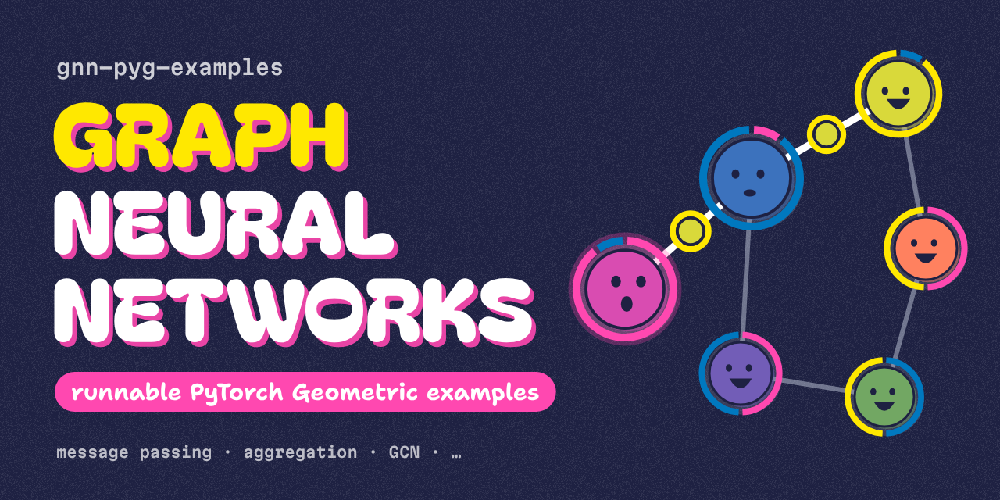

Small, runnable [PyTorch Geometric](https://pytorch-geometric.readthedocs.io/) examples that explain how graph neural
networks work. Open a module and you'll see just its GNN, in `gnn.py`, explained in plain docstrings. If you want to
see it in action, its `story/` folder runs the model on six friends and prints a short story. Each module also has a
README that walks through the idea, and a companion video.

> ▶ **Videos:** every module has a companion video on [my YouTube channel](https://www.youtube.com/channel/UC8sEwtZPRADZHXzlOGDHXyw).

&#160;

______________________________________________________________________

## Quick start

```bash
uv sync
uv run python -m modules.message_passing.story
uv run python -m modules.aggregation.story
```

Each module runs on a CPU in a few seconds. To run both at once: `just run`.

Tested with Python 3.13, torch 2.14.1 and torch-geometric 2.8.1. Run [mise](https://mise.jdx.dev/) `install` to get
the pinned Python, uv and just.

&#160;

______________________________________________________________________

## Modules

| module | video | idea | what you'll see |
| --- | --- | --- | --- |
| [01 Message passing](modules/message_passing/) | [▶ watch](https://www.youtube.com/watch?v=segXtOfZbG8) | How one GNN layer works | Nancy's update worked out by hand and checked against PyG, information travelling 2 hops, a tiny GNN learning who's a foodie, and over-smoothing |
| [02 Aggregation](modules/aggregation/) | [▶ watch](https://www.youtube.com/watch?v=TevxIaGq7Cs) | How a node combines its neighbours' messages | Sum vs mean vs max, what each one forgets, and GCN's edge weights |

&#160;

______________________________________________________________________

## Layout

```
common/                  shared, reusable code
├── story.py             Story base class: builds the graph, seeds, runs each chapter in order
├── narrator.py          Narrator: numbered sections, aligned tables, labelled facts
├── config.py            settings (seed, log level, training hyperparameters)
├── logger.py            the project logger
├── enums/               Friend, Taste, Aggregation
└── graph/               the six-friends graph (models, factories, six_friends) and star_graph
modules/
├── message_passing/
│   ├── gnn.py           the GNN: start here
│   ├── story/           optional: story.py · trainer.py, runs the GNN and prints the walkthrough
│   └── README.md
└── aggregation/
    ├── gnn.py
    ├── story/           story.py
    └── README.md
tests/                   mirrors common/ and modules/
```

&#160;

______________________________________________________________________

## The graph

Every module uses the same six friends. Each person is a node, and each friendship is an undirected edge.

```
Joe ── Nancy ── Bill
         │        │
        Mei      Omar
         │        │
       Priya ─────┘
```

Each friend's features are their tastes, written as `[music, outdoors, food]`:

| node | friend | music | outdoors | food |
| ---: | --- | ---: | ---: | ---: |
| 0 | Joe | 0.9 | 0.1 | 0.0 |
| 1 | Nancy | 0.1 | 0.9 | 0.0 |
| 2 | Bill | 0.0 | 0.1 | 0.9 |
| 3 | Mei | 0.5 | 0.5 | 0.0 |
| 4 | Priya | 0.0 | 0.5 | 0.5 |
| 5 | Omar | 0.5 | 0.0 | 0.5 |

&#160;

______________________________________________________________________

## Development

```bash
just fmt        # format and lint with ruff, mdformat and yamlfmt
just validate   # format check + mypy --strict + pytest with 100% coverage
just --list --list-submodules   # every recipe, including the per-part ones
```

Each part of the codebase has its own justfile in [`justfiles/`](justfiles/) (`common`, `modules`, `repo`), and the
root `justfile` delegates to them. Run one part on its own with e.g. `just common test` or `just modules mypy`.

<details>
<summary>Using pip instead of uv</summary>

```bash
pip install -r requirements.txt --extra-index-url https://download.pytorch.org/whl/cpu
python -m modules.message_passing.story
```

</details>
